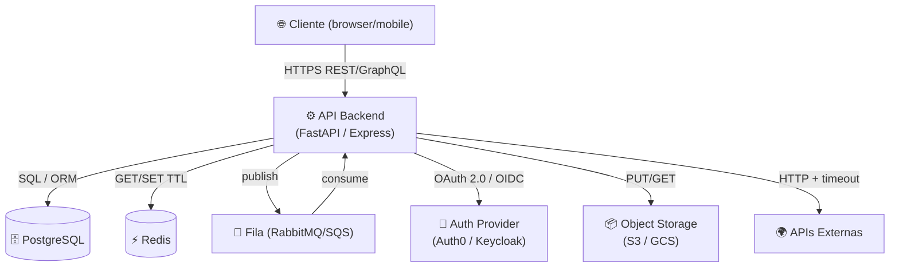

# Skill: Arch Tradeoff — Mapeamento de Tradeoffs Arquiteturais

Analisa o projeto e **mapeia todos os tradeoffs arquiteturais de forma explícita**. A maioria dos projetos toma decisões de arquitetura implicitamente — este skill as torna visíveis, documentadas e revisáveis.

> **Nome do projeto nos artefatos gerados**: resolva `{{PROJECT_NAME}}` em runtime — canon `gemeo/00-CANON/canon.yaml` → CLAUDE.md → nome do diretório raiz. Nunca emita `{{PROJECT_NAME}}` cru nos documentos gerados.

Gera três artefatos:
1. **`integration-map.md`** — diagrama Mermaid de todos os sistemas integrados
2. **`tradeoff-map.md`** — tabela de decisões com "escolhemos X, abrindo mão de Y"
3. **`adr-NNNN-tradeoffs.md`** — ADR formal (Architecture Decision Record) com contexto, decisão e consequências

---

## Etapas

### 1. Receber o alvo

O usuário pode fornecer:
- **Caminho absoluto**: `/home/johnny/GIT/PH3A/MeuProjeto`
- **Relativo ou nome**: `../MeuProjeto` ou `MeuProjeto`
- **Sem argumento**: usar o diretório de trabalho atual (`pwd`)

### 2. Varredura de integrações (arch-scan)

Executar a detecção automática de integrações:

```bash
ROOT=<PROJETO_ROOT>

# Diretórios de produção DESCOBERTOS (pastas de primeiro nível, sem testes/dependências): o alvo pode usar
# backend/ + frontend/, api/ + web/, src/... Nunca assuma os nomes.
cd "$ROOT"   # caminhos RELATIVOS: o `grep -v test|spec` abaixo olha a linha inteira, caminho absoluto incluído
DIRS=$(ls -d */ 2>/dev/null | grep -Ev "^(node_modules|dist|build|coverage|migrations|e2e|tests|test|__tests__|scripts|venv|\.venv|env|vendor|bin|obj|target|docs|examples|out)/$" | tr '\n' ' ')
# Lista de exclusão ÚNICA (a mesma do memory-guard.js e do resilience-scan.js), por nome de pasta; o `docs/` fica de fora
# porque é para onde ESTA skill escreve (o inventário leria o próprio relatório).
EXCL="--exclude-dir=node_modules --exclude-dir=__tests__ --exclude-dir=tests --exclude-dir=test --exclude-dir=dist --exclude-dir=build --exclude-dir=coverage --exclude-dir=migrations --exclude-dir=e2e --exclude-dir=scripts --exclude-dir=venv --exclude-dir=.venv --exclude-dir=env --exclude-dir=vendor --exclude-dir=bin --exclude-dir=obj --exclude-dir=target --exclude-dir=docs --exclude-dir=examples --exclude-dir=.next --exclude-dir=out --exclude-dir=__pycache__ --exclude-dir=site-packages"

echo "=== VARREDURA DE INTEGRAÇÕES ==="

# ── URLs e endpoints externos ─────────────────────────────────────────────────
echo "--- URLs hardcoded / variáveis de ambiente externas ---"
grep -rn "https\?://\|EXTERNAL_URL\|API_URL\|WEBHOOK_URL\|BASE_URL" \
  $DIRS \
  --include="*.py" --include="*.ts" --include="*.js" --include="*.env.example" $EXCL \
  2>/dev/null | grep -v "localhost\|127\.0\|test\|spec\|node_modules" | head -20

# ── SDKs de terceiros ─────────────────────────────────────────────────────────
echo "--- SDKs de terceiros ---"
cat */requirements.txt requirements.txt 2>/dev/null | grep -v "^#\|fastapi\|sqlalchemy\|pydantic\|pytest\|uvicorn\|alembic" | head -20
cat package.json */package.json 2>/dev/null | python3 -c "import json,sys; d=json.load(sys.stdin); [print(k) for k in d.get('dependencies',{}) if k not in ['react','vue','axios','express','fastify','typescript']]" 2>/dev/null

# ── Filas / mensageria ────────────────────────────────────────────────────────
echo "--- Filas e mensageria ---"
grep -rn "rabbitmq\|kafka\|sqs\|sns\|celery\|redis\|bull\|BullMQ\|amqp\|pika" \
  . $EXCL --include="*.py" --include="*.ts" --include="*.js" --include="*.env.example" \
  --include="docker-compose*.yml" 2>/dev/null | grep -v "node_modules\|test\|spec" | head -15

# ── Banco de dados ────────────────────────────────────────────────────────────
echo "--- Bancos de dados ---"
grep -rn "postgresql\|mysql\|mongodb\|redis\|elasticsearch\|DATABASE_URL\|REDIS_URL\|MONGO_URI" \
  . $EXCL --include="*.env.example" --include="docker-compose*.yml" --include="*.py" \
  2>/dev/null | grep -v "node_modules" | head -10

# ── Auth / identity ───────────────────────────────────────────────────────────
echo "--- Auth providers ---"
grep -rn "oauth\|oidc\|auth0\|keycloak\|cognito\|OAUTH_\|AUTH_URL" \
  . $EXCL --include="*.py" --include="*.ts" --include="*.env.example" \
  2>/dev/null | grep -v "node_modules\|test" | head -10

# ── CDN / storage ────────────────────────────────────────────────────────────
echo "--- Storage / CDN ---"
grep -rn "s3\|gcs\|azure_blob\|cloudinary\|S3_BUCKET\|STORAGE_URL" \
  . $EXCL --include="*.py" --include="*.ts" --include="*.env.example" \
  2>/dev/null | grep -v "node_modules\|test" | head -10

# ── Resiliência: ausência de timeout/retry ───────────────────────────────────
echo "--- Integrações sem timeout detectado ---"
grep -rn "httpx\.\|requests\.\|axios\.\|fetch(" \
  $DIRS \
  --include="*.py" --include="*.ts" --include="*.js" $EXCL \
  2>/dev/null | grep -v "timeout\|test\|spec" | head -15
# (a linha da chamada pode não trazer o timeout: ele costuma estar nas linhas seguintes — confirme lendo o arquivo)
```

Consolidar os resultados antes de continuar.

### 3. Ler arquivos de configuração

```bash
cat <PROJETO_ROOT>/.env.example 2>/dev/null
cat <PROJETO_ROOT>/docker-compose.yml 2>/dev/null | grep -A2 "image:\|ports:"
cat <PROJETO_ROOT>/infra/compose.yml 2>/dev/null | grep -A2 "image:\|ports:"
```

### 4. Gerar os artefatos

Criar o diretório `docs/arch/` se não existir.

---

#### 4.1 — `docs/arch/integration-map.md`

Template base — **preencher com os dados reais coletados na varredura**:

```markdown
# Mapa de Integrações — {{PROJECT_NAME}}

> Gerado por `/arch-tradeoff` em {{DATA}}. Atualize ao adicionar novas integrações.

## Diagrama



## Inventário de Integrações

| Sistema | Tipo | Protocolo | Timeout | Retry | Circuit Breaker | Criticidade |
|---------|------|-----------|---------|-------|-----------------|-------------|
| PostgreSQL | Banco primário | TCP / SQL | ✅ conn pool | ✅ via ORM | ❌ | Alta |
| Redis | Cache / Sessão | TCP | ✅ | ❌ | ❌ | Média |
| RabbitMQ / SQS | Mensageria | AMQP / HTTPS | ✅ | ✅ nativo | ❌ | Média |
| Auth0 / Keycloak | Autenticação | HTTPS / OIDC | ⚠️ verificar | ⚠️ verificar | ❌ | Alta |
| S3 / GCS | Storage | HTTPS | ⚠️ verificar | ❌ | ❌ | Média |
| API Externa N | Enriquecimento | HTTPS REST | ❌ ausente | ❌ | ❌ | Baixa |

> ❌ = ausente (risco), ⚠️ = verificar, ✅ = presente
```

---

#### 4.2 — `docs/arch/tradeoff-map.md`

Template base — **preencher com os tradeoffs reais do projeto**:

```markdown
# Mapa de Tradeoffs — {{PROJECT_NAME}}

> Decisões arquiteturais explícitas. Cada linha responde: "O que escolhemos, por quê, e o que sacrificamos."

## Modelo de análise

Usamos os frameworks **CAP** (Consistency, Availability, Partition tolerance) e **PACELC** (Partition: Availability vs Consistency; Else: Latency vs Consistency) para estruturar os tradeoffs.

## Tabela de Tradeoffs

| # | Decisão | Escolhemos | Abrindo mão de | Racional | Quando revisar |
|---|---------|-----------|----------------|----------|----------------|
| 1 | Consistência vs Disponibilidade (cache) | **Eventual** (Redis TTL) | Leitura sempre atualizada | Latência < 10ms justifica stale reads | Se dados financeiros ou de saúde entrarem no cache |
| 2 | Comunicação entre serviços | **HTTP síncrono** | Desacoplamento temporal | Simplicidade de depuração e tracing | Se latência p99 de chamadas > 500ms ou se um serviço cair causar cascata |
| 3 | Autenticação | **JWT stateless** | Revogação instantânea de tokens | Sem roundtrip ao auth server por request | Se requisito de revogação imediata surgir (regulatório) |
| 4 | Banco de dados | **PostgreSQL único** | Escalabilidade horizontal de writes | ACID completo, sem complexidade de distribuição | Se writes > 10k/s ou se precisar de multi-região ativa/ativa |
| 5 | Mensageria | **Fila por consumo** | Streaming em tempo real | Simplicidade operacional | Se consumers precisarem de < 100ms de latência fim-a-fim |
| 6 | Deploy | **Containers (Docker)** | Bare metal performance | Portabilidade e reprodutibilidade de ambiente | Se overhead de virtualização impactar SLA |

## Alertas de Resiliência

Os seguintes pontos de integração **não possuem timeout ou retry** — risco de cascata de falhas:

| Integração | Problema | Impacto | Ação recomendada |
|-----------|---------|---------|-----------------|
| API Externa N | Sem timeout configurado | Pode bloquear threads indefinidamente | Adicionar `timeout=5.0` + `/resilience-guard` |
| Auth Provider | Sem circuit breaker | Falha do IdP derruba todo o login | Implementar CB com fallback de cache |

```

---

#### 4.3 — `docs/arch/adr-NNNN-tradeoffs.md`

Determinar o próximo número de ADR verificando `ls docs/arch/adr-*.md 2>/dev/null | wc -l` e incrementar.

Template:

```markdown
# ADR-NNNN: Mapeamento de Tradeoffs Arquiteturais — {{PROJECT_NAME}}

**Data:** {{DATA}}
**Status:** Aceito
**Decidido por:** Equipe de Arquitetura PH3A

---

## Contexto

{{PROJECT_NAME}} integra N sistemas externos e toma decisões de arquitetura que impactam consistência, disponibilidade, latência e manutenibilidade. Este ADR documenta os principais tradeoffs para torná-los explícitos e revisáveis.

## Motivação

Tradeoffs implícitos são dívidas arquiteturais invisíveis. Quando um requisito muda (ex: exigência regulatória de revogação imediata de sessões), não se sabe qual decisão anterior precisa ser revisada. Documentar os tradeoffs permite:
- Identificar rapidamente o que muda quando um requisito muda
- Onboarding mais rápido de novos membros
- Revisões periódicas estruturadas

## Decisões e Consequências

### 1. Consistência eventual no cache Redis

**Decisão:** Cache com TTL; não invalidamos manualmente.
**Consequência positiva:** Latência de leitura < 5ms sem roundtrip ao banco.
**Consequência negativa:** Dados podem estar desatualizados por até [TTL] segundos.
**Gatilho de revisão:** Dados financeiros, dados médicos ou dados com SLA de atualização < TTL.

### 2. Comunicação HTTP síncrona entre serviços

**Decisão:** REST HTTP direto sem mensageria entre serviços internos.
**Consequência positiva:** Tracing simples, depuração local, sem infraestrutura de fila adicional.
**Consequência negativa:** Falha de um serviço propaga-se imediatamente; sem buffer de absorção.
**Gatilho de revisão:** Se latência p99 > 500ms ou se ocorrer uma cascata de falhas em produção.

### 3. Integrações externas sem circuit breaker (dívida técnica ativa)

**Decisão atual:** Chamadas a APIs externas sem CB implementado.
**Risco:** Timeout ou indisponibilidade de API externa pode bloquear threads do pool.
**Ação planejada:** Implementar `/resilience-guard` na próxima sprint de hardening.

## Revisão periódica

Este ADR deve ser revisado:
- Trimestralmente pela equipe de arquitetura
- Sempre que uma nova integração externa for adicionada
- Após qualquer incidente de disponibilidade

## Referências

- CAP Theorem: https://en.wikipedia.org/wiki/CAP_theorem
- PACELC: https://en.wikipedia.org/wiki/PACELC_theorem
- Resilience patterns: `/resilience-guard`
```

---

#### 4.4 — `scripts/arch-tradeoff-scan.sh`

> Nome próprio de propósito: `scripts/arch-scan.mjs` é do `/arch-guard` (fronteiras de camada). Dois "arch-scan" no mesmo `scripts/` confundem quem lê e quem roda.

```bash
#!/usr/bin/env bash
# scripts/arch-tradeoff-scan.sh
# Detecta integrações externas e pontos sem resiliência.
# Usado internamente por /arch-tradeoff e pode ser rodado manualmente.
set -euo pipefail

ROOT="$(cd "$(dirname "$0")/.." && pwd)"
# Diretórios de produção DESCOBERTOS (pastas de primeiro nível, sem testes/dependências): o alvo pode usar
# backend/ + frontend/, api/ + web/, src/... Nunca assuma os nomes.
cd "$ROOT"   # caminhos RELATIVOS: o `grep -v test|spec` abaixo olha a linha inteira, caminho absoluto incluído
DIRS=$(ls -d */ 2>/dev/null | grep -Ev "^(node_modules|dist|build|coverage|migrations|e2e|tests|test|__tests__|scripts|venv|\.venv|env|vendor|bin|obj|target|docs|examples|out)/$" | tr '\n' ' ')
# Lista de exclusão ÚNICA (a mesma do memory-guard.js e do resilience-scan.js), por nome de pasta; o `docs/` fica de fora
# porque é para onde ESTA skill escreve (o inventário leria o próprio relatório).
EXCL="--exclude-dir=node_modules --exclude-dir=__tests__ --exclude-dir=tests --exclude-dir=test --exclude-dir=dist --exclude-dir=build --exclude-dir=coverage --exclude-dir=migrations --exclude-dir=e2e --exclude-dir=scripts --exclude-dir=venv --exclude-dir=.venv --exclude-dir=env --exclude-dir=vendor --exclude-dir=bin --exclude-dir=obj --exclude-dir=target --exclude-dir=docs --exclude-dir=examples --exclude-dir=.next --exclude-dir=out --exclude-dir=__pycache__ --exclude-dir=site-packages"

echo "=== Arch Scan — Inventário de Integrações ==="
echo "Projeto: $ROOT"
echo ""

ISSUES=0

check() {
  local label="$1"; local cmd="$2"
  echo "[$label]"
  eval "$cmd" 2>/dev/null || true
  echo ""
}

check "URLs externas (não-localhost)" \
  "grep -rn 'https\?://' $DIRS $EXCL --include='*.py' --include='*.ts' --include='*.js' 2>/dev/null | grep -v 'localhost\|127\.0\|test\|spec\|node_modules' | head -15"

check "Dependências de terceiros (Python)" \
  "cat */requirements.txt requirements.txt 2>/dev/null | grep -v '^#\|fastapi\|sqlalchemy\|pydantic\|pytest\|uvicorn' | head -20"

check "SDKs Node.js externos" \
  "cat package.json */package.json 2>/dev/null | grep -A1 '\"dependencies\"' | head -20"

check "Chamadas HTTP sem timeout" \
  "grep -rn 'httpx\.\|requests\.get\|requests\.post\|axios\.\|fetch(' $DIRS $EXCL --include='*.py' --include='*.ts' 2>/dev/null | grep -v 'timeout\|test\|spec' | head -15"

check "Mensageria / Filas" \
  "grep -rn 'rabbitmq\|kafka\|sqs\|sns\|celery\|bull\|amqp' . $EXCL --include='*.py' --include='*.ts' --include='*.yml' 2>/dev/null | grep -v 'node_modules\|test' | head -10"

check "Auth providers" \
  "grep -rn 'oauth\|oidc\|auth0\|keycloak\|cognito' . $EXCL --include='*.py' --include='*.ts' --include='*.env.example' 2>/dev/null | grep -v 'test\|node_modules' | head -10"

echo "✓ Arch scan concluído. Revise os achados acima."
```

### 5. Confirmar criação

```
✓ docs/arch/integration-map.md criado
✓ docs/arch/tradeoff-map.md criado
✓ docs/arch/adr-NNNN-tradeoffs.md criado
✓ scripts/arch-tradeoff-scan.sh criado

Próximos passos:
  1. Revise e preencha os templates com os dados reais do seu sistema
  2. Identifique as integrações sem timeout/retry na tabela de inventário
  3. Marque os tradeoffs que precisam de revisão próxima
  4. Para fechar os alertas de resiliência: execute /resilience-guard
  5. Commite a documentação junto com o código — ela é um artefato vivo
```

---

## Exemplos de uso

```
/arch-tradeoff
/arch-tradeoff /home/johnny/GIT/PH3A/MeuProjeto
```

---

## Referências

- CAP Theorem: https://en.wikipedia.org/wiki/CAP_theorem
- PACELC Theorem: https://en.wikipedia.org/wiki/PACELC_theorem
- ADR (Architecture Decision Records): https://adr.github.io/
- C4 Model: https://c4model.com/
