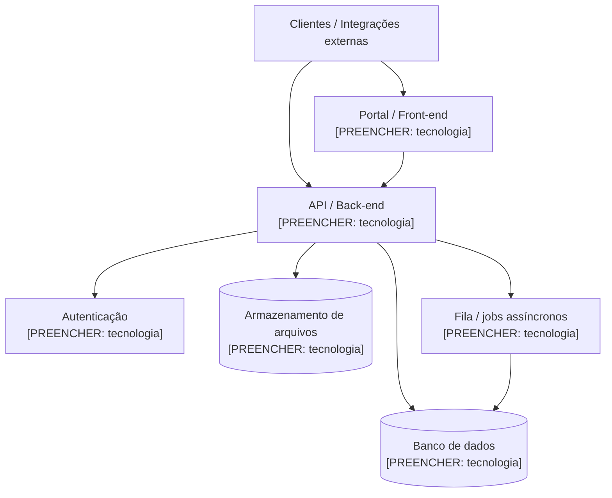

# Arquitetura — visão de componentes resumida

> **Template** — preenchido via /montar-gemeo. Deriva do canon: `produto.{implementado,em_construcao}`.
> **Citação parseável**: todo número preenchido usa o marcador `R$ X [canon: path.do.campo]` ou `N [calc: metrica]` — o CI compara com o canon e acusa drift (specs/001-melhorias-gemeo/contracts/formatos-arquivos.md).

> Visão de alto nível para alimentar decisões de negócio (custo, risco, dependência).
> **Resuma; não duplique documentação do repo** — diagramas detalhados, contratos
> internos e variáveis de ambiente vivem no código. Aqui: um diagrama e uma tabela.

## Diagrama de componentes

> Substitua os rótulos pelos componentes reais. O esqueleto genérico abaixo serve
> à maioria dos SaaS multi-tenant: clientes e integrações entram por uma borda,
> passam por portal e/ou API, que falam com persistência, auth, storage e fila.

## Componentes

> Uma linha por componente. Marque o **componente crítico** (ver critério abaixo).

| Componente | Responsabilidade | Tecnologia | Crítico? |
|------------|------------------|------------|:--------:|
| `[PREENCHER: componente]` | `[PREENCHER: o que faz]` | `[PREENCHER]` | |
| `[PREENCHER: componente]` | `[PREENCHER: o que faz]` | `[PREENCHER]` | ⭐ |
| `[PREENCHER: componente]` | `[PREENCHER: o que faz]` | `[PREENCHER]` | |

## Como escolher o COMPONENTE CRÍTICO

> Não copie a escolha de outro gêmeo. É o componente de maior **raio de impacto** se
> falhar: o que está no caminho de maior carga/latência, o que isola os tenants
> (vazar dados entre clientes seria fatal), ou aquele cuja indisponibilidade derruba
> a proposta de valor central. Marque-o com ⭐ na tabela e justifique em uma frase.

`[PREENCHER: qual é o componente crítico e por quê — 1 frase]`
