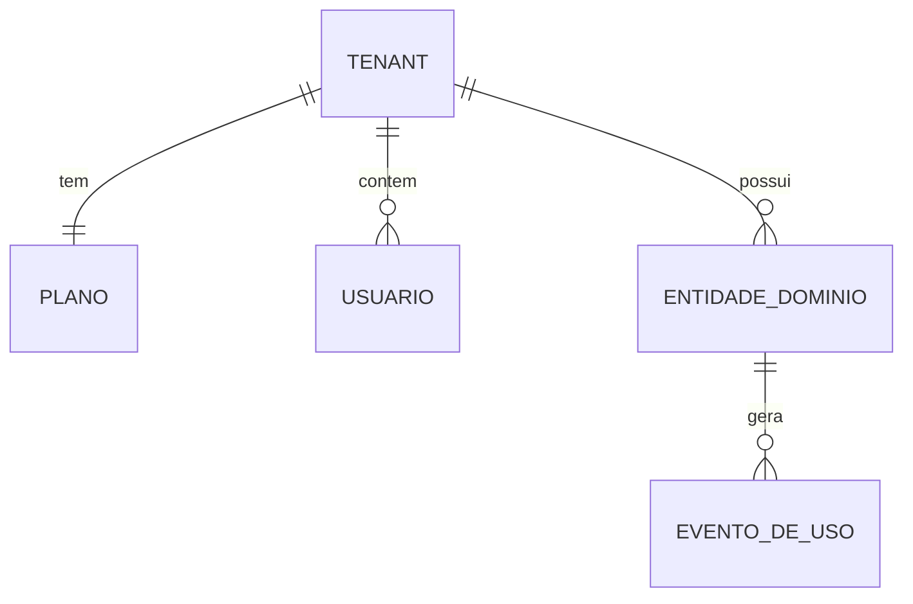

# Schema — entidades e relações em alto nível

> **Template** — preenchido via /montar-gemeo. Deriva do canon: `snapshot.uso_produto.*` (quais tabelas alimentam cada métrica de uso).
> **Citação parseável**: todo número preenchido usa o marcador `R$ X [canon: path.do.campo]` ou `N [calc: metrica]` — o CI compara com o canon e acusa drift (specs/001-melhorias-gemeo/contracts/formatos-arquivos.md).

> Visão de alto nível das entidades — o suficiente para entender o modelo de dados
> e de onde saem as métricas de uso. **Resuma; não duplique documentação do repo:
> NÃO copie as migrações** (`schema.sql`/`migrations/`) — elas são a fonte de verdade
> e vivem no código. Aqui ficam só entidades, relações e a origem das métricas.

## Diagrama de entidades (alto nível)

> Substitua pelos nomes reais. O esqueleto cobre o caso multi-tenant comum: um
> tenant raiz, suas configurações/planos, seus usuários, e as entidades de domínio.

## Entidades principais

| Entidade | Papel | Isolamento multi-tenant |
|----------|-------|-------------------------|
| `[PREENCHER: tenant/organização]` | `[PREENCHER: raiz do isolamento]` | `[PREENCHER: chave de tenant]` |
| `[PREENCHER: plano/assinatura]` | `[PREENCHER: limites e cobrança]` | por tenant |
| `[PREENCHER: usuários]` | `[PREENCHER: acesso]` | por tenant |
| `[PREENCHER: entidade de domínio]` | `[PREENCHER: objeto central do produto]` | por tenant |
| `[PREENCHER: evento de uso]` | `[PREENCHER: registro de cada uso/transação]` | por tenant |

## Origem das métricas de uso

> Mapeie cada chave de `snapshot.uso_produto.*` à tabela/contagem que a alimenta.
> É o que conecta o banco real ao canon (usado por `/atualizar-produto`).

| Métrica (`snapshot.uso_produto.*`) | Tabela / contagem de origem |
|------------------------------------|-----------------------------|
| `[PREENCHER: chave de uso]` | `[PREENCHER: COUNT em qual tabela]` |
| `[PREENCHER: chave de uso]` | `[PREENCHER: COUNT em qual tabela]` |

## Observações

- Isolamento entre clientes (regras de acesso por linha/tenant) é requisito de
  segurança — `[PREENCHER: como é garantido, em 1 frase]`.
- Dados pessoais seguem LGPD: `[PREENCHER: ex. retenção e anonimização, em 1 frase]`.
