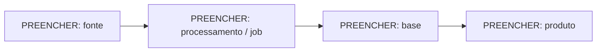

# Linhagem — da fonte ao produto

> **Template.** Responde à pergunta que mais importa numa crise: "se a fonte X cair (ou mudar, ou o
> contrato vencer), o que para e quem é afetado?". Ponto único de falha aparece aqui antes de aparecer
> em incidente.

[PREENCHER: data de referência AAAA-MM-DD]

---

## Fluxo

---

## Dependências críticas

| Se parar… | Para / degrada | Clientes afetados | Alternativa |
|---|---|---|---|
| [PREENCHER: fonte ou job] | [PREENCHER] | [PREENCHER] | [PREENCHER: fonte reserva, cache, nenhuma] |

---

## Pontos únicos de falha

[PREENCHER: fontes sem alternativa, jobs sem dono, conhecimento que só uma pessoa tem]
